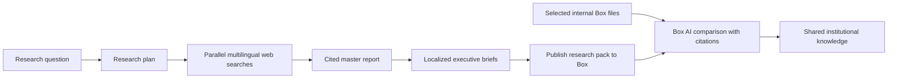

# The Global Signal Desk

**Building durable multilingual research with Temporal, OpenAI, Box, and Box AI.**

The Global Signal Desk turns one research question into a cited external-research report,
multilingual executive briefs, a machine-readable source manifest, and a Box AI decision brief
that compares the report with explicitly selected internal Box files. Temporal coordinates the
long-running process and publishes every generated artifact into a configured Box folder.

Research languages and output languages are configured separately. The first controls which
local-language evidence the query plan must cover; the second controls which localized briefs are
published.

This repository adapts Temporal's
[`basic_openai_python`](https://github.com/temporalio/ai-cookbook/tree/main/deep_research/basic_openai_python)
deep-research recipe.

## What happens



The OpenAI Responses API performs planning, structured generation, hosted web search, synthesis,
and localization. Box AI then compares the uploaded external report with the internal Box file IDs
configured for the run. Internal file content stays in Box; the final digest separates external
signals, internal observations, alignments, tensions, actions, and citations.

Each run writes files like these into the destination folder:

```text
global-signal-20260722-143000-a1b2c3d4--master-report.md
global-signal-20260722-143000-a1b2c3d4--brief-english.md
global-signal-20260722-143000-a1b2c3d4--brief-french.md
global-signal-20260722-143000-a1b2c3d4--brief-japanese.md
global-signal-20260722-143000-a1b2c3d4--brief-portuguese.md
global-signal-20260722-143000-a1b2c3d4--brief-polish.md
global-signal-20260722-143000-a1b2c3d4--sources.json
global-signal-20260722-143000-a1b2c3d4--box-ai-digest.md
```

## Prerequisites

- Python 3.11–3.14
- [`uv`](https://docs.astral.sh/uv/getting-started/installation/)
- [Temporal CLI](https://docs.temporal.io/cli)
- An OpenAI API key with access to the configured models and web search
- A Box account with Box AI available
- A Box Platform App allowed to read/write content and use Box AI

## 1. Configure OpenAI

Create an API key in the [OpenAI API dashboard](https://platform.openai.com/api-keys). The project
uses the Responses API with structured output and hosted web search.

The defaults are:

```dotenv
OPENAI_COMPLEX_MODEL=gpt-5.6-sol
OPENAI_FAST_MODEL=gpt-5.6-terra
```

You can override either model in `.env` if your project uses different model aliases.

## 2. Configure Box for the local demo

The quickest local path uses a short-lived Box developer token:

1. Open the [Box Developer Console](https://app.box.com/developers/console).
2. Create or open a Box Platform App.
3. Enable these application scopes:
   - **Read all files and folders stored in Box**
   - **Write all files and folders stored in Box**
   - **Manage AI**
4. Authorize the application if your Box enterprise requires admin approval.
5. On the app's **Configuration** page, generate a developer token.
6. In Box, create a folder named `Global Signal Desk`.
7. Open that folder and copy its numeric ID from the URL.
8. Select 1–24 existing internal Box files that the authenticated identity may read, and copy their
   numeric file IDs. The project does not discover, create, or broaden access to internal content.

The identity associated with the developer token must be able to upload to that folder and use
Box AI. Developer tokens normally expire after about 60 minutes; generate a fresh one when the
worker starts returning authentication errors.

For a deployed service, replace developer-token authentication with an enterprise-approved OAuth,
JWT, or Client Credentials Grant flow. Do not store production credentials in `.env` files.

## 3. Create local configuration

```bash
cp .env.example .env
```

Edit `.env`:

```dotenv
OPENAI_API_KEY=your_openai_api_key
BOX_DEVELOPER_TOKEN=your_short_lived_box_developer_token
BOX_FOLDER_ID=your_global_signal_desk_folder_id
BOX_INTERNAL_FILE_IDS=first_internal_file_id,second_internal_file_id
```

The project never prints credential values. `.env` is excluded from Git.

## 4. Install dependencies

```bash
uv sync --dev
uv run python scripts/check_env.py
```

## 5. Run the demo

Use three terminals from the repository root.

### Terminal 1 — Temporal development server

```bash
mkdir -p .temporal
temporal server start-dev --db-filename .temporal/temporal.db
```

Temporal Web is available at [http://localhost:8233](http://localhost:8233).
The local SQLite file keeps workflow history available across development-server restarts. URLs
from an earlier ephemeral server cannot be recovered; start a new workflow and use its new URL.

### Terminal 2 — worker

```bash
uv run python -m worker
```

### Terminal 3 — start research

```bash
uv run python -m start_workflow \
  "Research current local-language industry publications, national film institute reports, festival programs, cinema association data, and platform research to compare how audiences in France, Japan, Brazil, and Poland discover independent films. Assess the roles of festivals, theatrical release, streaming platforms, critics, creators, and social communities. The final Box AI decision brief must compare this external evidence with the distributor's internal Box campaign retrospectives and market plans, clearly distinguishing public findings from internal context. Identify evidence gaps and implications for market-specific release strategies." \
  --industry creative-industries \
  --research-languages French Japanese Portuguese Polish \
  --languages English French Japanese Portuguese Polish
```

Keep Terminal 2 running until Terminal 3 prints the Box file IDs.

## Other demo prompts

### Life sciences

```bash
uv run python -m start_workflow \
  "How is decentralized clinical-trial participation evolving across the EU, Japan, and Brazil? Focus on public regulatory guidance and operational trends." \
  --industry life-sciences \
  --research-languages English Japanese Portuguese \
  --languages English Japanese Portuguese
```

### Creative industry

```bash
uv run python -m start_workflow \
  "How do Gen Z audiences discover independent film in France, Japan, Brazil, and Poland, and what differs by market?" \
  --industry creative-industries \
  --research-languages French Japanese Portuguese Polish \
  --languages English French Japanese Portuguese Polish
```

The outputs are research drafts for qualified human review. They are not financial, medical,
regulatory, or legal advice.

## How Box AI is used

Box AI is an explicit internal-context workflow stage:

1. Temporal uploads the master report to Box.
2. The worker calls Box AI Ask with that report plus the explicitly configured internal file IDs.
3. Box AI analyzes those files server-side and returns citations.
4. Temporal receives a combined decision brief that distinguishes external and internal evidence.
5. The worker publishes `box-ai-digest.md` beside the research report.

Box AI Ask accepts at most 25 files in this mode, so the demo allows one generated report plus up
to 24 internal files. A Box Hub can support a larger curated knowledge collection, but Hub querying
is not implemented by this repository.

If the app lacks **Manage AI**, the account lacks Box AI access, or the authenticated identity
cannot read the uploaded report, the workflow stops at the Box AI stage with a visible Activity
error in Temporal Web.

## Retry and data behavior

- Box uploads use deterministic names based on the Temporal Workflow ID.
- An Activity retry updates the existing Box file as a new version instead of creating a duplicate.
- Box credentials are loaded only by Activities and do not enter Temporal Workflow history.
- Internal file IDs enter Workflow history, but the internal file bodies do not. Box AI reads the
  files within Box.
- Report content and research results do enter Workflow history in this educational implementation.
  For large or sensitive production reports, use encrypted payloads or Temporal's external payload
  storage pattern and pass references rather than full documents.
- The integration does not create shared links or add collaborators.

## Test without credentials

The end-to-end workflow test replaces OpenAI, Box, and Box AI calls with mocked Activities:

```bash
uv run pytest
uv run ruff check .
```

## Project structure

```text
activities/
  invoke_model.py          OpenAI Responses API Activity
  box_publish.py           Box upload, Box AI, and digest Activities
agents/
  research_planning.py
  research_query_generation.py
  research_web_search.py
  research_report_synthesis.py
  localized_brief.py
workflows/
  deep_research_workflow.py
scripts/
  check_env.py
start_workflow.py
worker.py
tests/
```

## References

- [Temporal AI Cookbook recipe](https://github.com/temporalio/ai-cookbook/tree/main/deep_research/basic_openai_python)
- [OpenAI web search](https://developers.openai.com/api/docs/guides/tools-web-search)
- [OpenAI structured outputs](https://developers.openai.com/api/docs/guides/structured-outputs)
- [Box file uploads](https://developer.box.com/reference/post-files-content)
- [Box AI Ask API](https://developer.box.com/reference/post-ai-ask)
- [Box Python SDK](https://developer.box.com/guides/tooling/sdks/python)

## Attribution

The research workflow is derived from the MIT-licensed examples in Temporal's AI Cookbook. This
repository adds multilingual briefs, Box publication, retry-safe file versioning, Box AI analysis,
configuration checks, and expanded tests and documentation.
